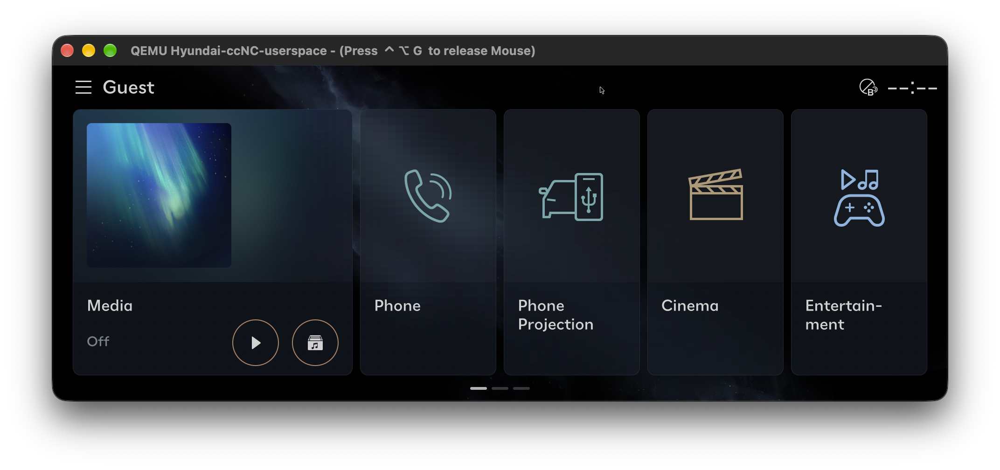
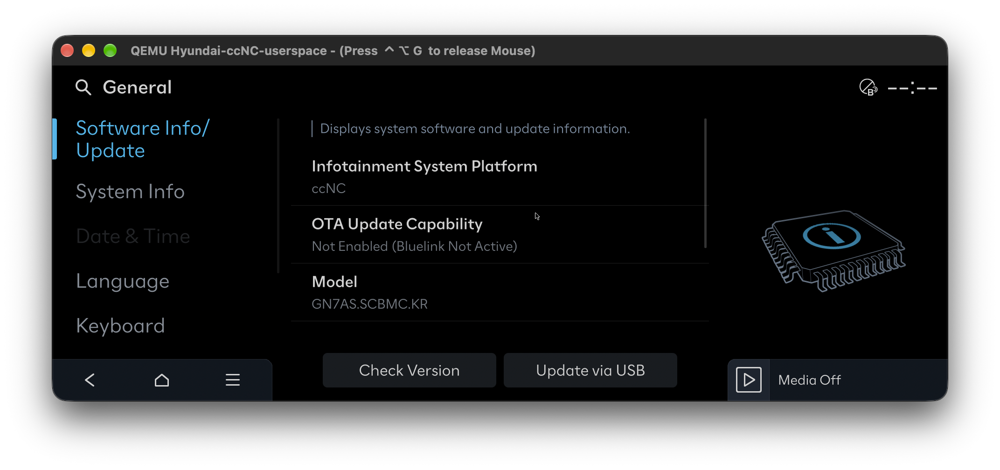
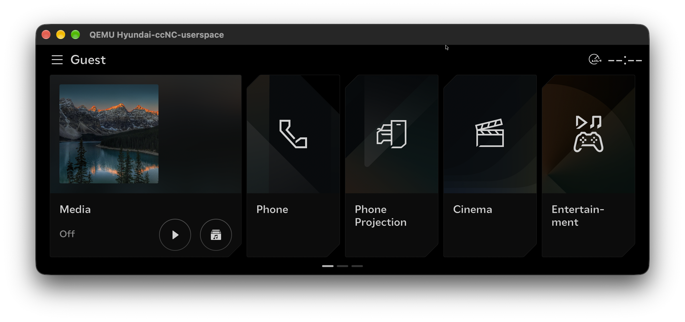
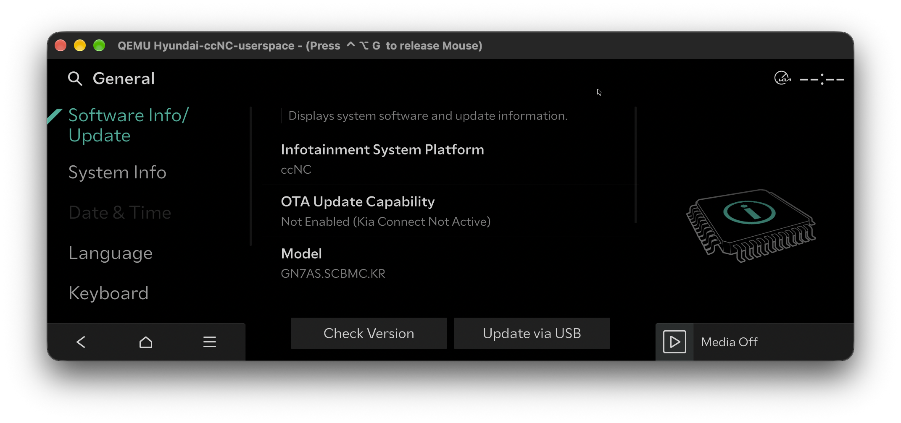

# Hyundai / Kia ccNC Emulator

Run original Hyundai/Kia ccNC ARM64 Linux applications in QEMU, including the
1920×720 dashboard, Settings, selected app screens, audio playback, and welcome
and goodbye animations.

This is a **ccNC userspace emulation environment**: QEMU provides a generic ARM
`virt` machine, an Alpine Linux kernel supplies device drivers, and compatibility
helpers let the original ccOS applications run. It does not reproduce the Tegra186
head unit, its automotive hypervisor, or the connected vehicle.

**Firmware is not included.** Obtain and prepare your own compatible firmware.
This repository does not download or decrypt Hyundai/Kia firmware. It contains
the lab scripts, compatibility source, dependency manifests, and documentation.
Decrypted images, extracted vendor files, application assets, downloaded packages,
generated binaries, recordings, logs, and persistent VM disks are excluded from Git.

## Screenshots

**Hyundai — Home dashboard running in QEMU**



**Hyundai — Settings → General → Software Info/Update**



**Kia — Home dashboard running in QEMU**



**Kia — Settings → General → Software Info/Update**



## Show the dashboard

After [supplying your firmware and completing setup](#set-up-from-a-fresh-clone),
open Terminal in the cloned repository folder and run:

```sh
python3 qemu/run.py --gui ccnc --display cocoa --state
```

This opens a **separate QEMU window containing the ccNC dashboard**. Terminal
continues to show the serial console. Wait about **25–40 seconds** for Home to
appear, then click inside the QEMU window to use it. Press **F1** (or **Fn+F1**)
to return to Home from another app.

You can also open the repository's **qemu** folder in Finder and double-click
**Launch dashboard.command**. Keep its Terminal window open while using the VM.

If you previously started a serial-only session, type `poweroff -f` at its
supervisor prompt, then start the dashboard using the command above. The `ccnc`
console command enters the firmware shell; use `--gui ccnc` when launching QEMU
to start the dashboard. The `--display cocoa` option explicitly selects the
visible macOS window.

## Prerequisites

The tested host is **macOS on Apple Silicon** with QEMU 11.1.3. Other hosts have
not been validated. Software CPU emulation is available with `--accel tcg`, but
the native GUI launcher currently uses QEMU's macOS Cocoa display backend.

| Requirement | Purpose |
| --- | --- |
| Apple Silicon Mac; 16 GB host RAM recommended | Default dashboard VM uses 4 GB RAM and two CPUs |
| Python **3.12 or newer** | Build scripts; Python standard library only |
| Homebrew | Install host tools |
| QEMU (`qemu-system-aarch64` and `qemu-img`) | ARM VM and persistent copy-on-write disks |
| LLVM and lld | Cross-compile ARM64 compatibility libraries |
| LZ4 | Unpack the supplied vendor boot payloads locally |
| dtc | Decode device trees during preparation |
| Internet access during initial setup | Download SHA-256-pinned Alpine and Debian dependencies |
| Local compatible firmware and disk space | Root filesystem is about 11.5 GiB; allow additional space for caches and VM state |

`e2fsprogs` is optional for offline ext4 inspection and USB test-image creation.
No Python packages, Docker, RTK, or host-installed FFmpeg are required to run
the dashboard. Animation playback uses FFmpeg already present in the guest image.

Install the host tools:

```sh
brew install python qemu llvm lld lz4 dtc
# Optional: USB fixture creation and ext4 inspection
brew install e2fsprogs
```

## Set up from a fresh clone

### 1. Clone the project

```sh
git clone https://github.com/kjwamlex/Hyundai_Kia_ccNC_Emulator.git
cd Hyundai_Kia_ccNC_Emulator
```

### 2. Supply your own firmware

The tested input is build `001.002.260813`, ccOS `5.0.49.0-40756073`, machine
`mst6g`, from the Korean package
`CCNC_SYSTEM_ALL_KOR_0000_00_001_002_260813_164608`.
Other builds may require different compatibility hooks and are not guaranteed
to work.

Put the following files from your own prepared firmware in a local `system/`
directory beside `qemu/`, preserving the filenames:

```text
Hyundai_Kia_ccNC_Emulator/
├── README.md
├── qemu/
└── system/                         # local only; ignored by Git
    ├── 1_gos1-fs_7_ext4.img         # unencrypted ext4 root filesystem
    ├── 1_4_tegra_dtb_zerosign.dtb
    ├── 1_5_kernel_zerosign.img
    ├── 2_4_tegra_dtb_zerosign.dtb
    ├── 2_5_kernel_zerosign.img
    └── 2_6_ramdisk_zerosign.img
```

Preparation inspects the vendor boot files and builds the generic QEMU boot
environment. It does not boot the vendor Tegra kernel. The root image is attached
read-only and is never modified by the emulator.

### 3. Check prerequisites and build

```sh
python3 qemu/setup.py --check
python3 qemu/setup.py
```

The setup command runs these steps in order:

```sh
python3 qemu/prepare.py
python3 qemu/compat/build.py
python3 qemu/compat/prepare-mesa.py
python3 qemu/prepare-audio.py
```

The scripts cache open-source downloads under `qemu/artifacts/` and build the
compatibility libraries and CPU graphics payload locally. No downloaded package
installation scripts run on the host. SHA-256 checks are enforced. Alpine netboot
URLs are rolling; if upstream replaces a pinned file, setup stops on a hash
mismatch. Keep a matching verified local cache, or update the corresponding
dependency set and hashes together after validating the replacement.

### 4. Open the dashboard window

From the repository's top-level folder, run:

```sh
python3 qemu/run.py --gui ccnc --display cocoa --state
```

Alternatively, double-click **qemu/Launch dashboard.command** in Finder.
The launcher offers **Hyundai**, **Kia**, or **Enter** to keep the saved brand.
Two windows are involved: Terminal shows the boot log and serial prompt, while
the separate **QEMU window shows the dashboard**. Allow about 25–40 seconds on
Apple Silicon. The console prints `CCNC_HMI_READY` and then `CCNC_APPS_READY`.
Click inside the QEMU window to send keyboard and mouse input to the guest.
Use **F1 / Fn+F1** to show Home again after opening another app.

macOS dashboard launches use CoreAudio by default; `--audio none` provides silent
emulated sound hardware. Examples using `--display none` run headlessly for
automated checks; use the command above for an interactive dashboard window.

## Switch Hyundai and Kia themes

Stop the VM with `poweroff -f` in its supervisor console, then select a brand
when launching:

```sh
python3 qemu/run.py --gui ccnc --display cocoa --state --brand kia
python3 qemu/run.py --gui ccnc --display cocoa --state --brand hyundai
```

The selection changes the original app branding, theme assets, and F6/F7 welcome
and goodbye videos. It takes effect at boot and is saved in the chosen `--state`
disk. Omit `--brand` to reuse that selection; without `--state`, it lasts for
the current session. A state disk with no saved choice uses the firmware's brand.
Custom video overrides still take precedence.

This selects branding within the supplied firmware; the vehicle model and
hardware remain those of that firmware. Switching brands refreshes the vendor
software variant cache from its configured defaults. Genesis is excluded because
this build does not include its theme and animation assets.

## Keyboard shortcuts

Use **Fn** with function keys if macOS reserves them for media/system controls.

| Key | Action |
| --- | --- |
| F1 | Home |
| F2 | Media |
| F3 | Phone |
| F4 | Audio / Sounds of Nature |
| F5 | Settings |
| F6 | Original welcome animation for the active brand |
| F7 | Original goodbye animation for the active brand; does not shut down |
| F8 | One-second audio test tone |
| F9 | Original engineering-mode password screen; valid credentials still required |

F6/F7 return to Home when playback finishes. The original raw video clips contain
no sound. Optional guest files `/ccos/data/qemu/welcome.wav` and `goodbye.wav`
provide accompanying audio; `welcome.264` and `goodbye.264` in the same directory
override the default clips.

## Firmware shell and persistent changes

For a shell without the dashboard:

```sh
python3 qemu/run.py --state
```

In the VM's serial console, enter the firmware environment:

```sh
ccnc
cd /ccos/services/welcomeaniservice/lhd/
ls -lh
```

`exit` returns to the small supervisor shell. From there, use `poweroff -f` to
flush writes and stop the VM.

With `--state`, writes are saved in `qemu/state/ccnc.qcow2`, separate from the
read-only original image. Without `--state`, writes use a disposable RAM layer
and disappear at shutdown. `/run` and `/tmp` remain temporary in both modes.
Use one VM per state disk; a separate path can be selected with
`--state /absolute/path/lab.qcow2`.

Startup copies the project compatibility payload into the guest again on each
launch. Edit those host-side helper sources to make lasting changes to the lab
helpers. To reset a state disk, stop the VM and rename its qcow2 file before the
next launch. A state disk depends on the original firmware image; keep that image
at its original path.

## What works and what remains incomplete

Verified features include the original Home dashboard, selected app screens,
OEM Back/Home/Menu controls, English/Korean language switching, Settings and
update dialogs, Sounds of Nature audio, volume/mute controls, and welcome/goodbye
playback. The app audit confirmed visible windows from 32 of 71 inspected HMI
directories, including system controls and connection dialogs. A visible screen
does not establish that the corresponding vehicle feature works.

The environment does not emulate the Tegra GPU, automotive hypervisor, vehicle
bus peers, cameras, physical DSP, radio tuners, Bluetooth calling, phone projection,
or the navigation hardware/backend. Vendor systemd is not PID 1, so `systemctl`
inside the firmware shell cannot manage the original full service graph.
The guest has no external network adapter by default.

See [the detailed runtime guide](qemu/README.md),
[app support results](qemu/APP_SUPPORT.md), and
[USB update investigation](qemu/USB_UPDATE_AUDIT.md).
Links to logs, extracted files, or screenshots in those investigations refer to
local generated evidence, which is deliberately not published.

## Validation

Basic original-userspace boot check:

```sh
python3 qemu/run.py --smoke
```

Headless welcome/goodbye keyboard and audio check:

```sh
python3 qemu/run.py --gui ccnc --display none --audio wav \
  --audio-file qemu/artifacts/display/welcome-test.wav \
  --job qemu/test-welcome.sh \
  --screenshot qemu/artifacts/display/welcome-test.png --welcome-test
python3 qemu/verify-audio.py qemu/artifacts/display/welcome-test.wav
```

Other regression jobs are documented in `qemu/README.md`. They require the user's
local firmware; hosted CI can only validate source files and publication boundaries.

## Troubleshooting

- **Missing firmware:** check the six filenames under the local `system/` directory.
- **Missing compatibility library or `swrast_dri.so`:** finish `python3 qemu/setup.py`.
- **Missing `clang`/`ld.lld`:** install Homebrew `llvm` and `lld`, then rerun setup.
- **No keyboard response:** click the QEMU window, wait for `CCNC_APPS_READY`, and
  try Fn with the function key.
- **Only a Terminal prompt appears:** launch with
  `python3 qemu/run.py --gui ccnc --display cocoa --state` from the repository
  root. This starts Home and opens its native macOS display window.
- **No sound:** use the default CoreAudio backend and F8 to check output. F6/F7
  are silent unless an optional WAV file is supplied.
- **State disk locked:** stop the other VM using that state file or select another.
- **Dependency hash mismatch:** do not bypass verification; see the cache and
  pinned-dependency notes above.

This is an independent project and is not affiliated with Hyundai, Kia, or Mobis.
See [NOTICE.md](NOTICE.md) for the repository's source-only distribution boundary.
