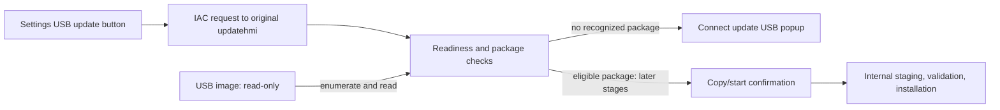

# USB update audit — November 4, 2026

USB discovery, ordinary file reads, internal file writes, and the original
Settings request/dialog path work in this QEMU environment. Writing back to USB
is deliberately blocked. A successful firmware installation has not been demonstrated.
These findings concern the emulator, not a physical vehicle.

## What pressing the button does

1. In General → SW information/update, the button is enabled by the ignition
   input. Its original QML calls `AEMManager.sendSWUpdatePrepare(0)`.
2. Settings sends `APP_REQUEST_UPDATE` to `UPDATE` through the original IAC
   service, with the USB update type. The original `updatehmi` handles it.
3. The UI checks startup version-scan completion, update state, vehicle inputs,
   USB mount state, and discovered packages. Package discovery also happens on
   mount/startup, before the button is pressed.
4. The DeviceManager adapter reports the actual lab mount at
   `/run/media/USB_Front`. The original HMI and service enumerate that directory.
   The adapter supplies simulated ignition, parked, zero-speed and camera-off
   inputs; it does not manufacture package acceptance or signature success.
5. Without a recognized package, the original popup says:
   “업데이트 소프트웨어가 저장된 USB를 연결한 후 다시 시도해 주십시오.”
   (“Connect a USB containing update software and try again.”)
   The no-USB case and mounted-but-empty case share this message. It therefore
   does **not** prove the USB device was unreadable or absent.
6. The firmware has a later copy/start confirmation scene. Its affirmative
   button calls `sendStartUpdate()`. That is separate from the Settings button.
   None of the completed negative-media tests reached a successful installation.



## Read and write locations

| Location | Behavior |
| --- | --- |
| Host USB image → guest `/dev/sda` | QEMU file and raw block layers are both read-only. |
| `/run/media/USB_Front` | Guest mount is `ro,nosuid,nodev,noexec`; ext4 also uses `noload`. |
| USB file reads | Read and SHA-256 calculation succeeded. Original scanner directory opens use `O_RDONLY`. |
| USB file creation/truncation | Both failed with `EROFS`, as intended. |
| Raw USB write access | Opening `/dev/sda` with `O_RDWR` failed with `EROFS`. |
| `/ccos/data/update` | Writable internal state/staging. A probe copied USB bytes here and read identical bytes back. Original HMI also creates/truncates `updateGroupStatus.json` and `updateStatus.json` here. |
| Internal persistence | Audit runs omitted `--state`, so writes used the disposable RAM overlay. Current dashboard launcher uses `--state`, which stores internal filesystem changes in a separate qcow2 disk. That does not make USB writable or supply NVIDIA flash devices. |
| Original firmware image | Attached read-only and mounted at `/firmware` with `ro,noload`. |

## Fresh runtime checks

| Scenario | Result | Evidence |
| --- | --- | --- |
| No USB attached | Passed original pointer-driven request, visible/focused popup, Confirm dismissal, and reopening. | `logs/audit-no-usb-host.log`, `artifacts/update/audit-no-usb.png` |
| Empty raw ext4 USB | Passed read/copy checks, all three write rejections, scanner activity and popup lifecycle. | `logs/audit-empty-host.log`, `artifacts/update/audit-empty.png` |
| Root `system_update.json` plus `system/` directory | Readable, but scanner reports `NoPkgFile`; same connect-update-USB popup. Fixture intentionally contains no firmware payloads. | `logs/audit-extracted-host.log`, `artifacts/update/audit-extracted.png` |
| Versioned `CCNC_SYSTEM_ALL_KOR_0000_00_001_002_260813_164608.zip` | HMI recognizes prefix/region and writes `updateUsbPkgList.json`; service skips the filename, then the same popup appears. The ZIP contains only the supplied manifest and a harmless marker. | `logs/audit-archive-host.log`, `artifacts/update/audit-archive.png` |
| MBR disk with ext4 in partition 1 | `/dev/sda1` mounted successfully. All I/O and popup lifecycle checks passed. | `logs/audit-partitioned-host.log`, `artifacts/update/audit-partitioned.png` |

Every successful GUI regression ends with `CCNC_JOB_EXIT=0`. The I/O probe emits
`CCNC_USB_READ_OK`, three `CCNC_USB_WRITE_BLOCKED ... EROFS` lines, and
`CCNC_USB_TO_INTERNAL_COPY_OK`. The probe is an ordinary file copy, not evidence
that the OEM package-copy stage completed.
SHA-256 hashes of all four attached fixture images were identical before and
after the audit. Results are recorded in `artifacts/update/audit-results.json`
and `artifacts/update/audit-hashes-{before,after}.json`.

The ZIP result exposes a difference between HMI discovery and service
eligibility. In `UpdatePackage::searchSystemPackage()` (`0xf61d0`), the service
uses `strrchr()` to find the final extension, compares it with `.enc`
(`0xf6390`–`0xf63ac`), and branches to the ` - skip : %s` log on mismatch.
There is also special handling for the exact name `CCNC_SYSTEM.zip`; it does not
make the tested versioned `.zip` eligible. This rejection happened during
filename selection, before any demonstrated cryptographic validation or flashing.

## What does not work, or remains unverified

- **Host USB passthrough:** `Launch dashboard.command` supplies `--gui ccnc
  --state`, with no `--usb-image`. A USB drive plugged into the Mac is not
  automatically exposed to the VM. Attach a raw image explicitly at VM startup.
- **USB writes:** intentionally unavailable through the current launcher and
  mount code. This is independent of whether internal storage is persistent.
- **Hotplug and eject:** boot-time mounting only. DeviceManager's unmount methods
  return unavailable (`13`); the adapter does not implement a complete USB
  insertion/removal/ejection lifecycle.
- **Extracted files as a package:** the tested loose manifest/directory layout
  was not recognized. Directory readability is insufficient for package discovery.
- **Tested versioned ZIP:** discovered by the HMI but skipped by the service's
  system-package filename filter. Renaming an archive to `.enc` would not supply
  the required package structure, compatibility or cryptographic validity.
- **FAT/exFAT:** mount branches exist in the code but were not exercised in this
  audit. Filesystems outside ext4/vfat/exfat enter the setup rescue path.
- **Cryptographic validation and full update:** no known-good signed USB
  distribution was available for this audit. Static disassembly shows
  `MAINCONFIG_G1.json` through `MAINCONFIG_G4.json` handling, RSA-signature
  classification, `OTACRYPT_*` verification/decryption, internal decryption and
  extraction directories, and further update stages. Their presence does not
  establish runtime success.
- **Hardware flashing:** the supplied manifest targets `/dev/vblkdev2p1`,
  `/dev/vblkdev2p2`, `/dev/vblkdev2p3` and NVIDIA boot partitions. The QEMU board
  lacks the NVIDIA hypervisor block interface, secure hardware, MICOM and vehicle
  ECU update interfaces. Persistent `/dev/vdb` storage does not implement these.

## Source and evidence

- Button: `artifacts/update/qml/general-0x3cfe5f.qml`, lines 91–115.
- Later copy/start confirmation: `artifacts/update/qml/update-0x2aa34c.qml`.
- QEMU attachment: `run.py`, USB block-device branch.
- Mount and internal-storage modes: `guest-init.sh`.
- Device and vehicle-state adapter: `overrides/opt/ccnc-qemu/lab-state.py`.
- New I/O regression: `test-update-io.sh`; original GUI checks: `test-update.sh`.
- Runtime logs include original DLT decisions and filtered `strace` file/directory
  calls from the OEM HMI and update service. Tracing is enabled only in the
  separate `artifacts/update/audit-overlay` copy; normal startup scripts and OEM
  binaries were not changed by this audit.
- Static service references: `artifacts/update/audit-service-references.txt`;
  package-name references: `artifacts/update/audit-hmi-package-references.txt`.

To repeat an attached-media check using the prepared audit overlay:

```sh
python3 qemu/run.py --gui ccnc --display none --audio none \
  --usb-image qemu/artifacts/update/usb-empty.img \
  --overlay qemu/artifacts/update/audit-overlay \
  --job qemu/test-update-io.sh \
  --screenshot qemu/artifacts/update/audit-repeat.png \
  --update-test --timeout 180
```

The audit overlay includes a copy of `test-update.sh` at
`opt/ccnc-qemu/test-update-original.sh`, used by the I/O wrapper.
